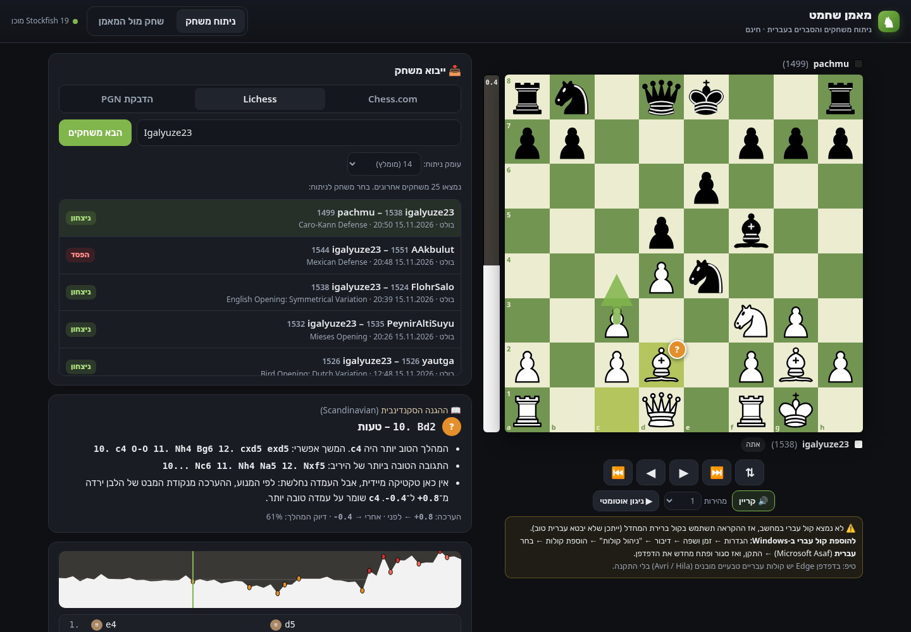
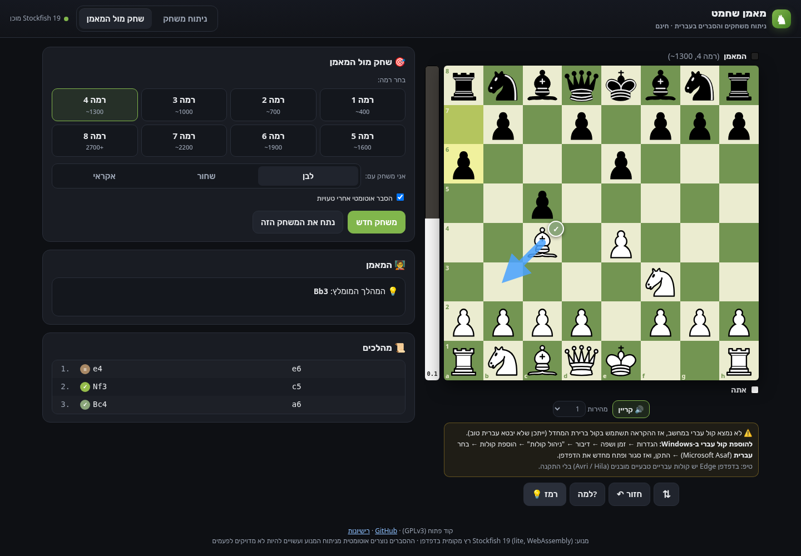
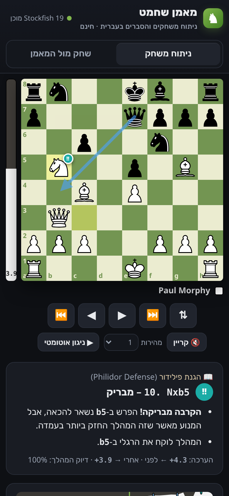

# ♞ מאמן שחמט בעברית – Hebrew Chess Coach

**מאמן שחמט "פרימיום" בחינם, עם ניתוח משחקים והסברים בעברית.** בהשראת Game Review ו-Coach של chess.com, אבל חינמי לגמרי, בלי הרשמה, ועובד גם בלי אינטרנט. מנוע Stockfish 19 רץ ישירות בדפדפן שלך.

🔗 **להפעלה אונליין:** https://igalyuze23.github.io/hebrew-chess-coach/

📱 **אפליקציית אנדרואיד:** [הורדת APK](https://igalyuze23.github.io/hebrew-chess-coach/download/hebrew-chess-coach.apk) (מתקינים מהקובץ ומאשרים התקנה ממקור לא ידוע; הניתוח והמשחק עובדים גם בלי אינטרנט)

| שחק מול המאמן | מובייל |
|---|---|
|  |  |

## ✨ יכולות

- **ייבוא משחקים** מ-Chess.com ומ-Lichess לפי שם משתמש (דרך ה-API הציבורי), או הדבקת PGN. שמות המשתמשים נשמרים בדפדפן.
- **ניתוח משחק מלא (Game Review):** Stockfish בודק כל מהלך (עומק 14 כברירת מחדל, אפשר 10–20).
- **סיווג מהלכים כמו ב-chess.com:** מבריק !!, מהלך גדול !, הטוב ביותר ★, מצוין, טוב, ספר (תיאוריה), אי-דיוק ?!, טעות ?, החמצה ✗, טעות גסה ??. הסיווג מבוסס על השינוי בסיכויי הניצחון.
- **אחוז דיוק** לכל צד, **פס הערכה**, **גרף הערכה** לחיץ, וחץ שמראה את המהלך הטוב ביותר.
- **הסברים בעברית לכל טעות:** מה היה המהלך הטוב יותר, כלי שנשאר תלוי, איום שלא טופל, לקיחה חינמית שפוספסה, מזלגות, הצמדות, מט ב-N, וכמה חומר המהלך עלה.
- **שם הפתיחה** בעברית (רשימת ECO מקוצרת) וזיהוי מהלכי תיאוריה.
- **סיכום משחק:** רגעי מפתח ומה כדאי לתרגל, לפי סוג הטעויות שלך.
- **שחק מול המאמן:** 8 רמות (בערך 400 עד 2700+), כפתור **רמז**, והסבר **"למה?"** אחרי כל מהלך שלך.
- **🔊 קריין בעברית:** מקריא את המהלכים, הסיווג והסבר קצר (Web Speech API). כולל שליטה במהירות ו**ניגון אוטומטי** של כל המשחק. במצב משחק הקריין אומר את מהלך המאמן ואת המשוב על המהלך שלך.
- **עיצוב כהה ומודרני**, מתאים למחשב ולנייד. ניווט בחצים במקלדת.
- **פרטיות:** הכל רץ אצלך בדפדפן. אין שרת ואין מעקב.

## 🚀 איך משתמשים

**אונליין:** נכנסים ל-https://igalyuze23.github.io/hebrew-chess-coach/

**במחשב (אופליין):** מורידים את הריפו (Code ← Download ZIP), מחלצים, ולוחצים לחיצה כפולה על `index.html`. עובד ב-Chrome, Edge ו-Firefox. אין צורך בשרת או בהתקנה. ייבוא משחקים דורש אינטרנט, אבל הניתוח לא.

**קול עברי לקריין (Windows):** הגדרות ← זמן ושפה ← דיבור ← ניהול קולות ← הוספת קולות ← עברית (Microsoft Asaf), ואז להפעיל מחדש את הדפדפן. בדפדפן Edge יש קולות עבריים טבעיים מובנים.

## 🛠️ פיתוח

הקוד נמצא ב-`src/`. אחרי שינוי, מריצים `python3 build.py` כדי לבנות מחדש את `index.html`. הפקודה `python3 build.py --bundle` בונה מחדש גם את `lib/sf-bundle.js`.

## 🙏 קרדיטים ורישיונות

- [Stockfish](https://stockfishchess.org/) דרך [Stockfish.js 19](https://github.com/nmrugg/stockfish.js) (גרסת lite, חוט יחיד, WebAssembly). רישיון **GPLv3**.
- [chess.js](https://github.com/jhlywa/chess.js) 0.13.4 מאת Jeff Hlywa. רישיון **BSD-2-Clause**.
- ערכת הכלים **cburnett** מאת [Colin M.L. Burnett](https://en.wikipedia.org/wiki/User:Cburnett), דרך [Lichess](https://github.com/lichess-org/lila). רישיון **GPLv2+**.
- הפרויקט כולו מופץ ברישיון **GPLv3** (ראו `LICENSE`), כי Stockfish כלול בו. פרטים נוספים ב-[`lib/README.md`](lib/README.md).

> 🤖 הפרויקט נבנה בעזרת בינה מלאכותית. ההסברים נוצרים אוטומטית מניתוח המנוע וייתכנו בהם אי-דיוקים.

---

# ♞ Hebrew Chess Coach

**A free "premium" chess coach with game analysis and explanations in Hebrew.** It's inspired by chess.com's Game Review and Coach, but it's completely free, needs no sign-up, and works offline. Stockfish 19 runs right in your browser.

🔗 **Live:** https://igalyuze23.github.io/hebrew-chess-coach/

📱 **Android app:** [Download the APK](https://igalyuze23.github.io/hebrew-chess-coach/download/hebrew-chess-coach.apk) (sideload it and allow installing from unknown sources; analysis and play work offline)

## Features

- **Import games** from Chess.com or Lichess by username through their public APIs, or paste a PGN. Usernames are saved in the browser.
- **Full Game Review:** Stockfish checks every move, at depth 14 by default (adjustable from 10 to 20).
- **chess.com-style move classes:** brilliant, great, best, excellent, good, book, inaccuracy, mistake, miss and blunder. They're based on the change in expected win %.
- **Accuracy** for each side, an **eval bar**, a clickable **eval graph**, and a best-move arrow.
- **Rule-based Hebrew explanations** built on top of the engine output, with no paid API. They cover the better move, hanging pieces, ignored threats, missed free captures, forks, pins, mate-in-N, and the material lost compared with the best move.
- **Opening names** in Hebrew from a small ECO list, plus book-move detection.
- **Game summary** with key moments and what to practise, based on your mistake patterns.
- **Play vs. the coach:** 8 levels (about 400 to 2700+), a **hint** button, and a **"why?"** explanation after each of your moves.
- **🔊 Hebrew narrator:** speaks each move, its class and a short explanation through the Web Speech API. It has speed control and an **autoplay** mode. In play mode it announces the coach's move and the feedback on your move.
- Dark, responsive design for desktop and mobile, with keyboard navigation.
- **Private:** everything runs locally in the browser, with no backend and no tracking.

## Usage

- **Online:** https://igalyuze23.github.io/hebrew-chess-coach/
- **Offline:** download the repo and double-click `index.html`. It works from `file://` because the engine's WASM file is bundled as base64 in `lib/sf-bundle.js`. Importing games needs internet; analysis doesn't.
- **Hebrew voice on Windows:** Settings → Time & Language → Speech → Manage voices → Add voices → Hebrew, then restart the browser. Edge also ships natural Hebrew online voices.

## Development

The sources are in `src/`. Run `python3 build.py` to regenerate `index.html`, and `python3 build.py --bundle` to also rebuild `lib/sf-bundle.js` from the Stockfish files.

## Credits & licenses

- [Stockfish](https://stockfishchess.org/) via [Stockfish.js 19](https://github.com/nmrugg/stockfish.js) (lite, single-threaded WASM). **GPLv3**.
- [chess.js](https://github.com/jhlywa/chess.js) 0.13.4 by Jeff Hlywa. **BSD-2-Clause**.
- The **cburnett** piece set by Colin M.L. Burnett, via [Lichess](https://github.com/lichess-org/lila). **GPLv2+**.
- The project as a whole is licensed under **GPLv3** (see `LICENSE`) because it bundles Stockfish. Third-party license files are in `lib/`.

> 🤖 Built with the help of AI. Explanations are generated automatically from engine output and may sometimes be imprecise.
